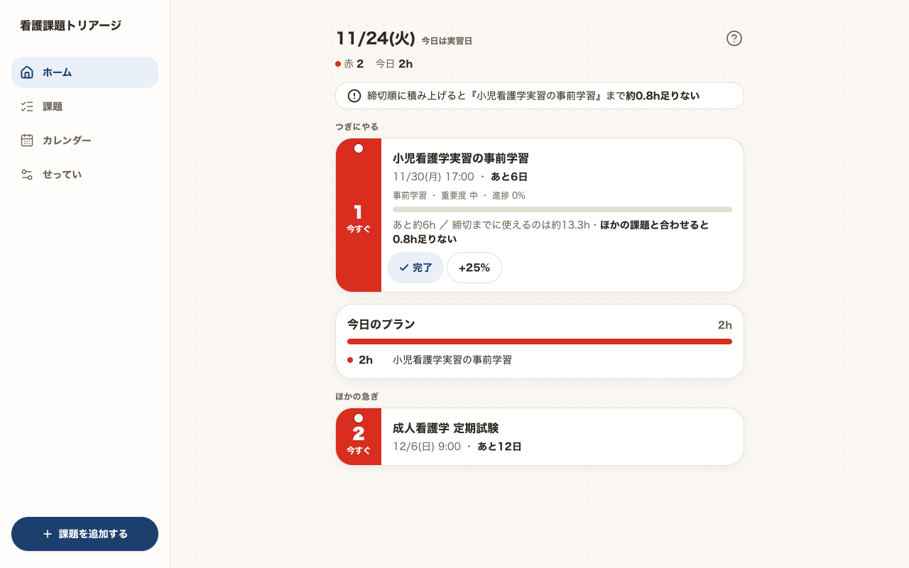
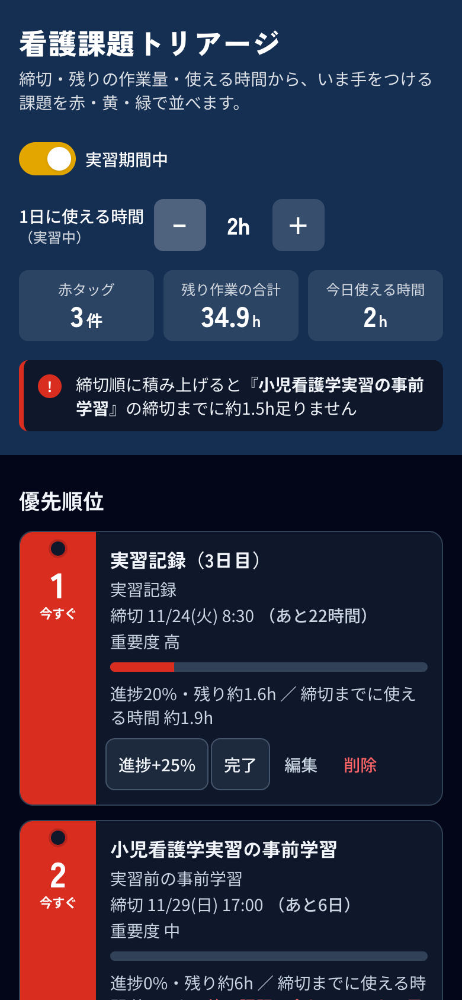

# 看護課題トリアージ

看護学生向けの、課題の優先順位を出す Web アプリです。
課題を「締切・残りの作業量・使える時間」から評価し、トリアージタッグのように **赤・黄・緑** で並べます。

**公開版：<https://nurse-triage-amber.vercel.app>**（データはブラウザ内だけに保存されます）

## 目的

実習期間中は、実習記録・看護過程・事前学習・技術試験・定期試験・国試対策が同時にやってきて、何から手をつけるか決められなくなりがちです。
このアプリを開けば、次の3つがすぐわかります。

- **いま何をやるか**：赤・黄・緑のタッグと順位
- **今日何時間ずつやるか**：1日に使える時間を上の課題から割り振った「今日のプラン」
- **このままだと間に合わない課題はどれか**：締切順に積み上げたときの時間不足の警告

## スクリーンショット

| PC（ライト）                                                                                                                                                          | スマホ（ダーク）                                                                                                                             |
| --------------------------------------------------------------------------------------------------------------------------------------------------------------------- | -------------------------------------------------------------------------------------------------------------------------------------------- |
|  |  |

実習期間中・1日2時間の例です。締切が6日後の「小児看護学実習の事前学習」は単体なら間に合いますが、締切の早い課題と合わせると1.5h足りないので赤になっています。

## 主な機能

- 課題の追加・編集・削除、進捗+25%（100%で自動で完了）、完了・完了一覧から「戻す」
- 完了・削除・全消去のあと5秒間「元に戻す」
- 実習期間中トグルと、1日に使える時間（実習中・通常期で別々に保存）
- 集計：赤タッグの件数／残り作業の合計／今日使える時間
- データはブラウザの localStorage に保存（ログイン不要・サーバーに送らない）
- スマホ対応（360px 幅〜）・ダークモード対応

## 優先度の決め方

課題ごとに次の値を計算します（`src/logic/priority.ts`）。

```
H       = 1日に使える時間（実習中なら実習中の値）
days    = 締切までの日数
remain  = 見込み時間 × (1 − 進捗/100)          … 残り作業時間
avail   = max(0, days) × H                     … 締切までに使える時間
ratio   = remain / max(avail, 0.1)             … 逼迫度
```

### 締切順の積み上げ（時間不足の判定）

未完了の課題を締切の早い順に並べて残り作業時間を足していき、その課題の締切までに使える時間を超えた分を **不足（shortage）** とします。
1件ずつの逼迫度だけでは「どれも単体なら間に合うのに、全部はこなせない」状態を見落とすためです。

### トリアージ

| タッグ           | 条件                                                                |
| ---------------- | ------------------------------------------------------------------- |
| 赤「期限切れ」   | 締切を過ぎている                                                    |
| 赤「今すぐ」     | 不足が 0.25h より多い、または ratio ≥ 0.7、または締切まで24時間未満 |
| 黄「早めに着手」 | ratio ≥ 0.3、または締切まで3日以内                                  |
| 緑「計画的に」   | それ以外                                                            |

### 並び順

赤 → 黄 → 緑の順。同じ色の中は次の score が高い順です。

```
score = (0.6 × min(ratio, 2)/2 + 0.4 × 1/(1 + max(days, 0))) × 種類の重み × 重要度 × 100
```

| 種類               | 重み |     | 種類           | 重み |
| ------------------ | ---- | --- | -------------- | ---- |
| 実習記録           | 1.5  |     | レポート       | 1.0  |
| 看護過程           | 1.4  |     | グループワーク | 1.0  |
| 実習前の事前学習   | 1.3  |     | 国試対策       | 0.9  |
| 技術試験・OSCE練習 | 1.25 |     | その他         | 0.8  |
| 定期試験・小テスト | 1.2  |     |                |      |

- 実習期間中は、実習記録と看護過程の重みに +0.2
- 重要度：低 0.8／中 1.0／高 1.25

### 今日のプラン

1日に使える時間を、並び順の上の課題から `min(残り作業時間, 残りの時間)` ずつ、0.5h 単位で割り振ります（`src/logic/plan.ts`）。余った時間は「空き：休む・復習にあてる」です。

## 起動方法

Node.js 22.12 以上が必要です。

```sh
git clone https://github.com/Soma2028/nurse-triage.git
cd nurse-triage
npm install
npm run dev        # 開発サーバー（http://localhost:5173）
```

| コマンド          | 内容                              |
| ----------------- | --------------------------------- |
| `npm run dev`     | 開発サーバーを起動                |
| `npm run test`    | テスト（Vitest）を実行            |
| `npm run build`   | 型チェックと本番ビルド（`dist/`） |
| `npm run preview` | ビルド結果をローカルで確認        |
| `npm run lint`    | ESLint                            |
| `npm run format`  | Prettier で整形                   |

## デプロイ

Vercel にデプロイしています（Vite プリセット、ビルドは `npm run build`、出力は `dist/`）。

```sh
npx vercel --prod
```

## 技術構成

- React + Vite + TypeScript
- Tailwind CSS v4
- 状態管理：`useReducer` + Context（外部ライブラリなし）
- 保存：localStorage（キー `nurse-triage-v1`）
- テスト：Vitest（優先度ロジック・プラン・reducer・保存・表示の整形）

```
src/
  types.ts / constants.ts   型定義・課題の種類プリセット
  logic/                    優先度計算とプラン（純粋関数）とテスト
  store/                    reducer・localStorage・サンプル課題・Context
  components/               画面の部品
  utils/format.ts           日付・時間の表示
```

## 今後やりたいこと

- ログインとクラウド同期（スマホと PC でデータを共有）
- 締切や今日のプランの通知
- 時間割や実習スケジュールの取り込み（実習日は使える時間を自動で減らす など）
