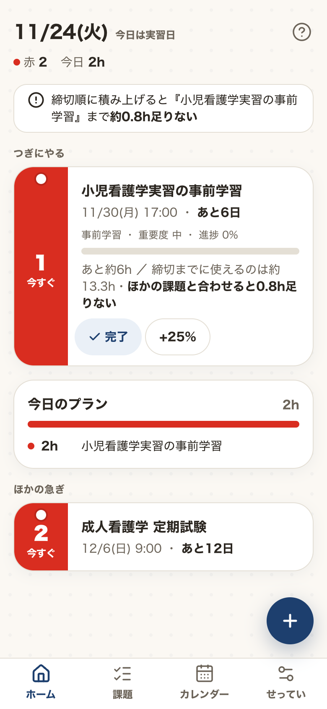
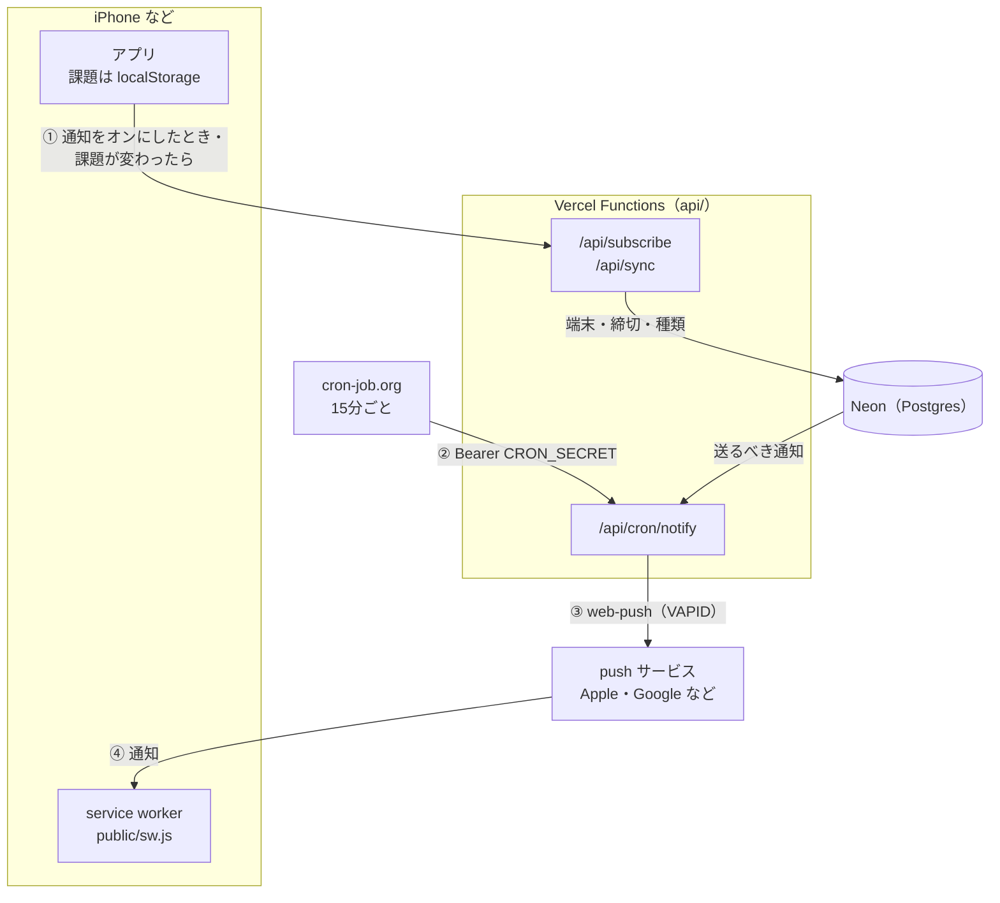

# 看護課題トリアージ

看護学生向けの、課題の優先順位を出す Web アプリです。
課題を「締切・残りの作業量・使える時間」から評価し、トリアージタッグのように **黒・赤・黄・緑** で並べます（黒は締切を過ぎた課題）。

**公開版：<https://nurse-triage-amber.vercel.app>**（課題はブラウザ内に保存。通知をオンにしたときだけ、締切と種類をサーバーに送ります）

## 目的

実習期間中は、実習記録・看護過程・事前学習・技術試験・定期試験・国試対策が同時にやってきて、何から手をつけるか決められなくなりがちです。
このアプリを開けば、次の3つがすぐわかります。

- **いま何をやるか**：黒・赤・黄・緑のタッグと順位
- **今日何時間ずつやるか**：1日に使える時間を上の課題から割り振った「今日のプラン」
- **このままだと間に合わない課題はどれか**：締切順に積み上げたときの時間不足の警告

## スクリーンショット

| スマホ：ホーム                                                                                                                                                                                                        | スマホ：課題                                                                                                                                                                         | PC：ホーム                                                                                                                               |
| --------------------------------------------------------------------------------------------------------------------------------------------------------------------------------------------------------------------- | ------------------------------------------------------------------------------------------------------------------------------------------------------------------------------------ | ---------------------------------------------------------------------------------------------------------------------------------------- |
|  |  |  |

実習期間中・1日2時間の例です。締切が6日後の「小児看護学実習の事前学習」は単体なら間に合いますが、締切の早い課題と合わせると0.8h足りないので赤になり、ホームの上に1行で知らせています。

## 主な機能

- **ホーム**：今日やることだけ。日付と今日の理由（今日は実習日・今日は休み・今日はテスト）、締切過ぎ・赤の件数と今日の時間の1行、つぎにやる1件、今日のプラン、プランに入らなかった黒・赤
- **課題**：優先順位の一覧（未完了／完了）。カードは2行（課題名／締切・残り）で、押すと根拠と、完了・+25%（100%で自動で完了）・編集・削除が開く。完了から「戻す」
- **追加・編集**：右下の＋から、画面の下からせり上がるシートで（取っ手を下に引いても閉じる）
- **カレンダー**：TimeTree のように、実習・休み・テストの予定と課題の締切を月の表に出す。表を左右になぞると前後の月に移る。上の年月を押すと、好きな月を選んで飛べる。右下の＋で実習・休み・テストの期間（土日を除くこともできる）や課題を追加、日付をタップでその日の予定を変えたり、その日が締切の課題を見たり追加したりできる。締切までに使える時間を日ごとの予定で計算し、今日が実習日なら「実習中」も自動でオン
- **せってい**：小見出しで分けた一覧。プロフィール（ログイン・フレンド）、実習期間中（切り替えはここだけ）、1日に使える時間（実習中・ふだん）、通知、ヘルプ（ホームの見方・優先度の決め方・カレンダーの使い方）、アカウント（ログアウト・退会）、すべて消す（もう一度たずねる）
- **通知**：締切の前の日・締切の少し前・赤の課題のまとめを、Web プッシュで知らせる。時刻はそれぞれ選べる（初期は前の日 20:00・3時間前・7:00）（iPhone はホーム画面に追加して使う）。課題名は初期設定では送らない（[通知](#通知)）
- **フレンド**：メールの6桁コードでログインし、プロフィール（ニックネーム・アイコン・学年・ひとこと）を作って、フレンドコード・招待リンク・QR でフレンドになる。今日完了した数と赤の数を見せ合い、応援のスタンプを送れる。課題名は送らない（[フレンド](#フレンド)）
- 完了・削除・全消去のあと5秒間「元に戻す」
- 課題はブラウザの localStorage に保存（課題を使うのにログインはいらない）。サーバーに送るのは、通知をオンにしたときの締切・種類・完了かどうかと、フレンドに見せる数だけ
- アプリのように、ページ全体はスクロールしない（見出しと下のタブは固定、真ん中だけが動く）。360px 幅〜、iPhone SE でもどのタブも同じ形。ライトのみ（ダークモードには対応しない）

## キャラクターの絵

`src/assets/chara/` に `normal.png`（ふつう）・`worry.png`（心配）・`happy.png`（うれしい）を置くと、ビルド時に自動で読み込まれて差し替わります。置いていない表情は仮の SVG のままです。透過 PNG・正方形（512px 推奨）で用意してください（詳しくは [src/assets/chara/README.md](src/assets/chara/README.md)）。

キャラクターは、空いた画面（課題がない・黒と赤の課題がないときのホーム、未完了がないときの課題）と、完了したときのトーストにだけ出ます。

## 優先度の決め方

課題ごとに次の値を計算します（`src/logic/priority.ts`）。

```
H       = 1日に使える時間（実習中なら実習中の値）
days    = 締切までの日数
remain  = 見込み時間 × (1 − 進捗/100)          … 残り作業時間
avail   = max(0, days) × H                     … 締切までに使える時間
ratio   = remain / max(avail, 0.1)             … 逼迫度
```

### 実習スケジュールがあるとき

今日以降の日に印が1つでもあると、`avail` を日ごとに合計します（`src/logic/schedule.ts`）。

| 日     | その日に使える時間 |
| ------ | ------------------ |
| 実習日 | 実習中の時間       |
| 印なし | 通常期の時間       |
| テスト | 通常期の時間       |
| 休み   | 0h                 |

```
avail = Σ（今〜締切 と重なる各日の時間 × その日と重なった割合）   ※日の区切りはローカル時刻の0時
```

- 今日が実習日なら「実習期間中」を自動で ON にします。トグルを押すと今日だけ手動で切り替えられます（翌日には自動判定に戻る）。
- 印のない日しかない（または過去の日にしか印がない）ときは、上の `max(0, days) × H` のまま、トグルも手動です。
- 60日より前の印は、次に開いたときに自動で消えます。

### 締切順の積み上げ（時間不足の判定）

未完了の課題を締切の早い順に並べて残り作業時間を足していき、その課題の締切までに使える時間を超えた分を **不足（shortage）** とします。
1件ずつの逼迫度だけでは「どれも単体なら間に合うのに、全部はこなせない」状態を見落とすためです。

### トリアージ

| タッグ           | 条件                                                                |
| ---------------- | ------------------------------------------------------------------- |
| 黒「締切過ぎ」   | 締切を過ぎている（締切ちょうどはまだ赤）                            |
| 赤「今すぐ」     | 不足が 0.25h より多い、または ratio ≥ 0.7、または締切まで24時間未満 |
| 黄「早めに着手」 | ratio ≥ 0.3、または締切まで3日以内                                  |
| 緑「計画的に」   | それ以外                                                            |

### 並び順

黒 → 赤 → 黄 → 緑の順。黒はいちばん上に出します（遅れて出すか、先生に連絡するかをすぐ決めるため）。同じ色の中は次の score が高い順です。

```
score = (0.6 × min(ratio, 2)/2 + 0.4 × 1/(1 + max(days, 0))) × 種類の重み × 重要度 × 100
```

| 種類               | 重み |     | 種類           | 重み |
| ------------------ | ---- | --- | -------------- | ---- |
| 実習記録           | 1.5  |     | レポート       | 1.0  |
| 看護過程           | 1.4  |     | グループワーク | 1.0  |
| 実習前の事前学習   | 1.3  |     | 国試対策       | 0.9  |
| 技術試験・OSCE練習 | 1.25 |     | その他         | 0.8  |
| 定期試験・小テスト | 1.2  |     |                |      |

- 実習期間中は、実習記録と看護過程の重みに +0.2
- 重要度：低 0.8／中 1.0／高 1.25

### 今日のプラン

1日に使える時間を、並び順の上の課題から `min(残り作業時間, 残りの時間)` ずつ、0.5h 単位で割り振ります（`src/logic/plan.ts`）。余った時間は「空き：休む・復習にあてる」です。

## 通知

締切が近い課題を、iPhone・Android・PC に Web プッシュ通知で知らせます（指示書は [SPEC-push.md](SPEC-push.md)）。
iPhone では、Safari の共有メニューから**ホーム画面に追加**して、そのアイコンから開いたときだけ受け取れます（iOS 16.4 以降）。

### しくみ



- **ローカル優先**：画面は今まで通り localStorage から表示します。サーバーへの同期は裏で行い、失敗しても画面と操作は止まりません（次の変更のときか、開き直したときに送り直します）
- **ログインなし**：端末ごとにランダムな `deviceId` と `secret` を作り、localStorage に置きます。サーバーには secret の SHA-256 だけを保存します
- 通知をオンにしていない端末は、サーバーに何も送りません
- そのほかの API：`/api/vapid-key`（VAPID の公開鍵。アプリは鍵をビルドに埋め込まず、ここから取る）
- Vercel Hobby の cron は1日1回までなので、定期実行には cron-job.org を使います

### サーバーに送るもの

| 送る                                     | 送らない                                     |
| ---------------------------------------- | -------------------------------------------- |
| 課題の ID・種類・締切・完了かどうか      | 課題名（初期設定）・見込み時間・進捗・重要度 |
| 通知の設定（タイミング・課題名を出すか） | 実習スケジュール・1日に使える時間            |

実習記録や関連図の課題名には、患者さんの情報（「A氏・心不全」など）が入りやすいためです。
「通知に課題名を出す」をオンにしたときだけ課題名を送り、オフのときはサーバー側でも保存しません（通知は「実習記録」のように種類名で出ます）。
「通知をやめる」を押すと、端末の登録と、サーバーにあるその端末のデータ（課題・送信記録）をまとめて消します。

### 通知のタイミング

時刻はすべて日本時間で計算します（`api/_lib/schedule.ts`。サーバーは UTC で動くので、固定の +9 時間で直す）。

| 通知             | いつ（初期値）                                    | 選べる時刻                    | 例                                     |
| ---------------- | ------------------------------------------------- | ----------------------------- | -------------------------------------- |
| 締切の前の日     | 締切の前の日の 20:00                              | 0:00〜23:45（15分刻み）       | 明日 8:30 締切：実習記録               |
| 締切の少し前     | 締切の3時間前                                     | 30分・1・2・3・4・6・12時間前 | あと3時間：看護過程                    |
| 赤の課題のまとめ | 毎日 7:00、赤の課題があるとき（端末ごとに1日1回） | 0:00〜23:45（15分刻み）       | 今日の赤タッグ 2件 ／ まず実習記録から |

- 時刻は通知のシートで選びます。設定は `devices.settings`（jsonb）に入るので、テーブルを変える必要はありません。時刻の項目がない古い設定は初期値として読みます
- 15分刻みなのは、cron が15分おきに動くためです

- cron は15分おきなので、「予定時刻 ≤ いま < 予定時刻 + 60分」のものを送ります（1回くらい cron が失敗しても取りこぼさない）
- 送る前に送信記録（`sent`）を付け、同じ通知は二度送りません。どこにも届かなかったときだけ記録を取り消し、次の回に送り直します
- 締切を変えた課題は、新しい締切で送り直します。完了した課題・締切を過ぎた課題には送りません
- まとめの送信記録はその日の 0:00 で残すので、時刻をあとにずらしても同じ日に二度は届きません。23:30 のような夜おそい時刻でも、日付をまたいだ分まで送りどきとして扱います
- **まとめの「赤」はサーバーでの簡易判定**です：締切まで24時間以内、または未完了の実習記録・看護過程。サーバーには見込み時間や進捗を送っていないため、アプリの黒・赤・黄・緑とずれることがあります（締切を過ぎた課題は数えません）
- push サービスから 404・410（宛先がもうない）が返った宛先は消します

### 自分でデプロイするときの設定

1. **Neon**：Vercel のプロジェクト → Storage → Neon（Free）でデータベースを作ると、`DATABASE_URL` が環境変数に入ります。地域は Vercel Functions と同じにします（公開版はどちらも iad1）
2. **テーブル**：Neon の SQL Editor に [migrations/001_init.sql](migrations/001_init.sql) を貼って1回実行します
3. **VAPID の鍵**：`npx web-push generate-vapid-keys` で公開鍵と秘密鍵を作ります
4. **環境変数**：Vercel の Settings → Environment Variables に、Production と Preview の両方で入れます（名前の一覧は [.env.example](.env.example)。値はリポジトリに入れない）

   | 名前                | 内容                                          |
   | ------------------- | --------------------------------------------- |
   | `DATABASE_URL`      | Neon の接続文字列（Storage から作れば自動）   |
   | `VAPID_PUBLIC_KEY`  | 3 の公開鍵                                    |
   | `VAPID_PRIVATE_KEY` | 3 の秘密鍵                                    |
   | `VAPID_SUBJECT`     | `mailto:自分のアドレス`                       |
   | `CRON_SECRET`       | `openssl rand -hex 32` などで作った長い文字列 |

5. **デプロイ**し直して、環境変数を反映します
6. **cron-job.org**：アカウントを作り「CREATE CRONJOB」
   - URL：`https://<公開URL>/api/cron/notify`、Execution schedule：Every 15 minutes
   - Advanced：Request method は `GET`、Headers に `Authorization` ＝ `Bearer <CRON_SECRET の値>`、Timeout 30秒
   - 「TEST RUN」で 200 と `{"ok":true,"devices":…,"sent":…}` が返れば設定完了（401 ならヘッダーを見直す）
   - Notifications で「execution fails」をオンにしておくと、止まったときにメールで気づけます
7. **確かめる**：iPhone でホーム画面から開き、せってい → 通知 →「通知」のスイッチをオン。締切を近くにした課題を入れて、通知が届くか見る

`npm run dev` では `/api` が動かないので、通知の登録はできません（画面の確認はできます）。API までローカルで動かすときは `npx vercel env pull` のあと `npx vercel dev` を使います。

## フレンド

ログインして、友だちと今日の進み具合を見せ合い、応援を送れます（指示書は [SPEC-social.md](SPEC-social.md)）。
ログインしなくても、課題・カレンダー・通知はいままでどおり使えます。

### できること

- **ログイン**：メールアドレスに届く6桁のコードで（パスワードなし。登録していなければそのまま登録）。ログアウトしても課題は端末に残る。退会すると、プロフィール・フレンド・申請・応援・進み具合をサーバーからまとめて消す
- **プロフィール**：ニックネーム（12文字まで）・アイコン（12種）・学年（1〜4年・ひみつ）・ひとこと（40文字まで）
- **フレンドになる**：どの方法でも「申請 → 相手が承認」
  - フレンドコード（8文字。0/O・1/I/L のような見分けにくい文字は使わない）を入れる
  - 招待リンク（`/f/コード`）を LINE などで送る。iPhone では Safari で開くので、ホーム画面のアプリでコードを入れる案内を出す
  - QR コードを出し、相手の iPhone のカメラで読んでもらう（中身は招待リンク）
  - おたがいに申請したら、そのままフレンドになる。フレンドは100人まで
- **申請・フレンドの整理**：断る・取り消す・フレンドをやめる・ブロック（相手には知らせない。ブロックされている人の申請は「見つからない」と同じ返事にする）
- **今日の進み具合**：フレンドの一覧に「今日 3件完了 ・ 赤 1」。見せるかどうかはスイッチで切り替え、やめるとサーバーの分も消す
- **応援**：スタンプ4種（がんばれ・おつかれ・いっしょにやろう・えらい）。同じ相手に1日（日本時間）3回まで。相手が通知をオンにしていれば「◯◯さんから応援が届いたよ」と届く

### サーバーに送るもの（フレンド）

| 送る                                                   | 送らない                                   |
| ------------------------------------------------------ | ------------------------------------------ |
| プロフィール（ニックネーム・アイコン・学年・ひとこと） | 課題名・課題の種類・締切・見込み時間・進捗 |
| 今日完了にした数・いまの赤の数・その日付               | 実習スケジュール・1日に使える時間          |
| フレンド・申請・ブロック・応援のスタンプ               | 写真（アイコンは用意した絵から選ぶ）       |

### しくみ

- ログインは **Clerk**（メールのコード）。画面は Clerk の既製の部品を使わず、自前のシートで作っている
- Clerk の公開キーは `/api/config` から取り、localStorage に置いて次の起動からすぐ使う。Clerk は大きいので、ログインまわりの部品は必要なときだけ読み込む（取れない・つながらないときは「いまはつながらないよ」と出し、課題などはそのまま使える）
- API はアプリから送られた Clerk のセッショントークンを `@clerk/backend` で確かめる（`Authorization: Bearer …`）

| API                        | 内容                                                                                 |
| -------------------------- | ------------------------------------------------------------------------------------ |
| `GET /api/config`          | Clerk の公開キー                                                                     |
| `GET・PUT /api/profile`    | 自分のプロフィールを読む・作る・直す（初めて作るときにフレンドコードを作る）         |
| `GET・POST /api/friends`   | 一覧（フレンド・申請・ブロック・届いた応援）と、申請・承認・ブロック・応援などの操作 |
| `PUT・PATCH /api/progress` | 今日の進み具合を置く・見せるかを切り替える                                           |
| `POST・DELETE /api/device` | 通知の端末にログインした人を付ける・ログアウトの前に外す（応援の通知のため）         |
| `DELETE /api/account`      | 退会（こちらのデータを消してから Clerk のアカウントを消す）                          |

### 自分でデプロイするときの設定（フレンド）

1. **Clerk**：<https://clerk.com> でアプリを作り、ログインの方法を「メール」だけにする。パスワードはオフ、メールの確認コードをオン
2. **環境変数**：Vercel に `CLERK_PUBLISHABLE_KEY` と `CLERK_SECRET_KEY` を Production と Preview の両方で入れる（Clerk の本番のキーには、`vercel.app` ではない自分のドメインが必要。開発用のキーでも動く）
3. **テーブル**：Neon の SQL Editor で [migrations/002_social.sql](migrations/002_social.sql) と [migrations/003_blocks.sql](migrations/003_blocks.sql) を1回ずつ実行する
4. 応援を通知で届けるには、通知の環境変数（VAPID）も入っている必要がある

## セキュリティ

- **ヘッダー**（`vercel.json`）：Content-Security-Policy で読み込み先を自分と Clerk・Cloudflare のロボット対策だけにしぼり、ほかのサイトの枠への埋め込みを禁止（`frame-ancestors 'none'`・`X-Frame-Options: DENY`）。ほかに `X-Content-Type-Options`・`Referrer-Policy`・`Permissions-Policy`・`Cross-Origin-Opener-Policy`
- **回数制限**（`api/_lib/rateLimit.ts`、テーブルは [migrations/004_rate_limits.sql](migrations/004_rate_limits.sql)）：上限を超えると 429

  | 操作                                           | 上限（1時間）           |
  | ---------------------------------------------- | ----------------------- |
  | フレンドコードを使う操作（申請・招待を調べる） | 1人20回（総当たり対策） |
  | そのほかのフレンドの操作                       | 1人120回                |
  | プロフィールの保存                             | 1人30回                 |
  | 今日の進み具合                                 | 1人300回                |
  | 通知の端末にログインを付ける・外す             | 1人30回                 |
  | 通知の登録                                     | 接続元ごとに20回        |
  | 課題の同期                                     | 接続元ごとに600回       |

  数えられないとき（テーブルがない・DB の不調）は、アプリを止めないよう通す。古い記録は cron（15分ごと）で消す

- **ログイン**：本番では、公開版のアドレスで作られた Clerk のトークンだけを受け付ける（localhost・プレビューは受け付けない）
- **秘密の値**：端末の secret はサーバーに SHA-256 だけ置き、比べるときは時間で中身がわからない方法で比べる。環境変数の値はリポジトリに入れない
- **使わない入口は置かない**：テスト通知の `/api/test` は消した

## 起動方法

Node.js 22.12 以上が必要です。

```sh
git clone https://github.com/Soma2028/nurse-triage.git
cd nurse-triage
npm install
npm run dev        # 開発サーバー（http://localhost:5173）
```

| コマンド          | 内容                              |
| ----------------- | --------------------------------- |
| `npm run dev`     | 開発サーバーを起動                |
| `npm run test`    | テスト（Vitest）を実行            |
| `npm run build`   | 型チェックと本番ビルド（`dist/`） |
| `npm run preview` | ビルド結果をローカルで確認        |
| `npm run lint`    | ESLint                            |
| `npm run format`  | Prettier で整形                   |

## デプロイ

Vercel にデプロイしています（Vite プリセット、ビルドは `npm run build`、出力は `dist/`）。

```sh
npx vercel --prod
```

通知を使うには、Neon・環境変数・cron-job.org の設定が必要です（[自分でデプロイするときの設定](#自分でデプロイするときの設定)）。

## 技術構成

- React + Vite + TypeScript
- Tailwind CSS v4（色は役割ごとのトークン、部品は `ui-*` の共通クラス）
- framer-motion（動きの決まりは `src/motion.ts`）、lucide-react（アイコン）
- 状態管理：`useReducer` + Context（外部ライブラリなし）
- 保存：localStorage（課題はキー `nurse-triage-v1`、通知の設定と端末の名札は `nurse-triage-push-v1`、ログインまわりは `nurse-triage-clerk-key` `nurse-triage-profile` `nurse-triage-friends` など）
- 通知：Vercel Functions（`api/`、Node.js）＋ Neon（Postgres、`@neondatabase/serverless`）、web-push（VAPID）、入力の検証は zod、定期実行は cron-job.org
- ログイン・フレンド：Clerk（`@clerk/react`・`@clerk/backend`）、QR コードは `qrcode-generator`
- テスト：Vitest（優先度ロジック・プラン・実習スケジュール・ホームに出すもの・reducer・保存・表示の整形・通知のルール・API・cron・同期・プロフィール・フレンド・進み具合・応援）。日付の境界を確かめるため `Asia/Tokyo` 固定で実行し、通知の時刻計算は UTC などでも同じ結果になることを確かめている

```
src/
  types.ts / constants.ts   型定義・課題の種類プリセット
  logic/                    優先度計算・プラン・実習スケジュール・ホームに出すもの（純粋関数）とテスト
  store/                    reducer・localStorage・サンプル課題・Context
  components/               4つの画面（Home/Tasks/Schedule/Settings）・メニュー・パネル・部品
  assets/chara/             キャラクターの画像
  utils/format.ts           日付・時間の表示
  sync/                     通知の登録・解除、課題の同期、対応端末の判定
  social/                   ログイン・プロフィール・フレンド・招待・進み具合・応援（Clerk を使うものは必要なときだけ読み込む）
api/
  subscribe.ts / sync.ts / test.ts / vapid-key.ts   通知の API
  config.ts / profile.ts / friends.ts / progress.ts / device.ts / account.ts   ログイン・フレンドの API
  cron/notify.ts            cron-job.org から15分ごとに呼ばれる
  _lib/                     通知のルール（schedule.ts）・DB・push・入力の検証、フレンドのルール（friends.ts など）とテスト
migrations/001_init.sql     通知のテーブル
migrations/002_social.sql   ログイン・プロフィール・フレンド・進み具合・応援のテーブル
migrations/003_blocks.sql   ブロックのテーブル
migrations/004_rate_limits.sql   API の回数制限のテーブル
vercel.json                 招待リンク（/f/コード）で index.html を返す・セキュリティのヘッダー
public/sw.js                通知を受け取る service worker（キャッシュはしない）
```

## 今後やりたいこと

- 課題のクラウド同期（スマホと PC でデータを共有。いまのログインはフレンドのためだけ）
- Apple でのログイン
- 時間割の取り込み（授業のある時間を使える時間から自動で引く）
- カレンダーファイル（.ics）からの実習スケジュールの読み込み
